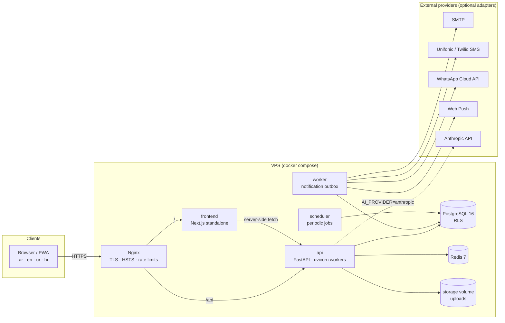

# Architecture

WESAL is a **modular monolith**: one FastAPI application split into business modules with explicit service
layers, one PostgreSQL database with row-level security, Redis for rate limiting, and two background
processes (outbox worker, scheduler). The web client is a Next.js application. The design keeps operations
simple on a single VPS while keeping module boundaries clean enough to extract services later.

## System diagram



Postgres and Redis sit on a Docker network with no internet route. Only Nginx publishes ports.

## Backend modules (`backend/app/modules`)

| Module | Responsibility |
|---|---|
| `auth` | Registration, email/SMS verification codes, login, OTP login, TOTP MFA + recovery codes, sessions, password reset |
| `businesses` | Business profile, documents & verification, team members & custom roles, branches, addresses, supplier coverage areas |
| `files` | Upload validation (magic bytes, re-encoding images, PDF active-content rejection) and authorized download |
| `catalog` | Product identity (shared, by barcode) vs supplier offers; brands; price lists (customer > region > default); promotions; CSV import; market search |
| `reps` | Representative profiles, verification, rep marketplace, company (employee) reps, tasks, targets |
| `authorizations` | Supplier ↔ representative authorizations (draft → sent → pending_rep → active → suspended/expired/cancelled), scope checks, commission agreements, immutable history |
| `crm` | Supplier & rep customer records, contacts, notes, opportunities, acquisition source & history |
| `visits` | Planned/started/ended visits, consent-based location at check-in/out, outcomes |
| `orders` | Carts, direct and rep orders, 17-state order engine, approvals with version + snapshot hash, supplier offers/changes, fulfilment, delivery confirmation, collections, invoices/PDF |
| `returns` | Return requests with evidence, supplier decisions, receipt, settlement |
| `commissions` | Commission calculation (most-specific rule), hold periods, approval, payout evidence, disputes, adjustments |
| `ratings` / `complaints` | Transaction-bound ratings with replies/reports; complaint threads with admin resolution |
| `notifications` | In-app notifications, per-event/channel preferences, dedupe, transactional outbox |
| `reports` | Role reports with CSV (BOM, formula-injection safe), XLSX (RTL sheets) and PDF (WeasyPrint, embedded fonts) in the document language |
| `ai` | Multilingual assistant: natural-language order parsing, scoped Q&A, reorder forecast, rep opportunities. Local deterministic engine by default, Claude adapter optional |
| `admin` | Verification queue, users, orders, complaints, commissions, catalog moderation, ratings, plans, ads, content pages, translation overrides, settings, audit log, system status |
| `privacy` | Personal data export, deletion (anonymisation) requests, ads delivery |
| `public` | Health, reference data, published pages, public stats, contact form |

Core infrastructure is in `backend/app/core`: configuration (`config.py`), database & RLS context (`db.py`),
dependencies/context resolution (`deps.py`), RBAC catalogue (`rbac.py`), audit (`audit.py`), errors with
localized messages (`errors.py`, `i18n.py`), rate limiting, storage, security primitives.

## Request lifecycle & tenant isolation

```mermaid
sequenceDiagram
  participant C as Client
  participant API as FastAPI
  participant D as deps.py
  participant DB as PostgreSQL (role wesal_app)
  C->>API: request + session cookie + X-CSRF-Token (+ X-Business-Id)
  API->>D: current_principal (session hash lookup, idle/absolute expiry)
  D->>D: BusinessCtx / RepCtx / AdminCtx<br/>(membership, permission, MFA for admin)
  D->>DB: BEGIN; set_config('wesal.user_id' / 'wesal.business_ids' / 'wesal.rep_id', local)
  API->>DB: queries (ORM)
  DB-->>API: rows filtered by RLS policies
  API->>DB: audit row (append-only), COMMIT
  API-->>C: JSON (localized errors, decimals as strings)
```

* The runtime role **does not own** any table and every tenant table has `FORCE ROW LEVEL SECURITY`.
  Policies use helper functions `wesal_uid()`, `wesal_bids()`, `wesal_rep()`, `wesal_bypass()`.
* The context is applied in the SQLAlchemy `after_begin` hook, so every transaction (including ones the
  application opens implicitly) carries it. A forged `X-Business-Id` is rejected unless the user is an active
  member; even a bug that skipped that check would return no rows from the database.
* `system_context(db)` is used for the few cross-tenant reads that are legitimate (e.g. resolving a supplier's
  public name on an order); it flushes and restores the previous context.
* Access denials are written to `audit_logs` in a separate transaction so they survive the rollback.

## Order engine

```mermaid
stateDiagram-v2
  [*] --> draft
  draft --> pending_retailer_approval: rep sends to store
  draft --> new: store submits
  pending_retailer_approval --> new: store approves (version + hash)
  pending_retailer_approval --> rejected
  pending_retailer_approval --> draft: store requests changes
  new --> supplier_review
  new --> approved: supplier accepts
  new --> quoted: supplier offers prices/qty
  supplier_review --> approved
  supplier_review --> quoted
  quoted --> approved: store accepts offer
  approved --> awaiting_retailer_approval: supplier change
  preparing --> awaiting_retailer_approval: supplier change
  awaiting_retailer_approval --> approved: store approves change
  approved --> preparing --> ready --> out_for_delivery --> delivered
  delivered --> completed: store confirms / auto after N days
  delivered --> partially_returned
  completed --> partially_returned
  partially_returned --> fully_returned
  delivered --> disputed
  completed --> disputed
  new --> rejected
  approved --> cancelled
```

The authoritative transition table is `orders/service.py::TRANSITIONS`; every transition writes an
append-only `order_status_history` row. Suppliers never see `draft` or `pending_retailer_approval` orders.
Each approval stores a JSON snapshot and its SHA-256; approving requires the client to echo the version and
hash it displayed, so a stale screen cannot approve a changed order.

## Commission engine

On approval an *estimated* commission is computed from the agreement attached to the authorization
(most specific rule wins: product > brand > category > all, then lowest priority number). On delivery/completion it becomes
*pending* for `hold_days`, then *due* (scheduler), *approved* by the supplier and *paid* when the supplier
uploads payout evidence. Returns create one adjustment per return (unique constraint); cancellation cancels.
One commission per (order, representative) — enforced by a unique index.

## Notifications

Business code calls `notify(...)`, which writes in-app notifications and **outbox rows** in the same
transaction (respecting user preferences and dedupe keys). The worker claims pending rows with
`FOR UPDATE SKIP LOCKED`, renders the localized template and sends through the configured provider, with
retries and backoff. Several workers can run safely.

## Scheduler jobs

`expire_authorizations`, `warn_expiring_authorizations`, `auto_complete_orders`, `release_commissions`,
`expire_offers`, `mark_missed_visits`, `retention_cleanup` — each run recorded in `job_runs`.

## Internationalisation

* Frontend: `next-intl` with `[locale]` routes (`/ar`, `/en`, `/ur`, `/hi`), `dir` switched per locale, logical
  CSS properties (`ms-`, `ps-`, `start`), fonts per script (IBM Plex Sans Arabic, Noto Nastaliq Urdu, Noto Sans
  Devanagari, Inter). 1,746 keys per locale; `npm run check:i18n` fails the build on missing or unused keys.
* Backend: error messages and notification templates in `app/locales/*.json`; `check-locales` and a test fail on
  missing keys. Admins can override strings at runtime (`translation_overrides`).
* Business data is multilingual where it matters (category/city/product names in `name_ar/name_en/...`).
* Documents (PDF/XLSX) are generated in the *document language*, which can differ from the UI language.

## AI assistant

`AI_PROVIDER=local` (default) uses deterministic parsing and `pg_trgm` similarity over the user's own
accessible catalogue — no data leaves the server. `AI_PROVIDER=anthropic` uses the Claude adapter
(`integrations/ai_anthropic.py`) with strict tools that only read data the user may already see; it never
creates prices or approves orders, and falls back to the local engine on any error. Admins can disable the
assistant entirely. The Claude adapter has **not** been exercised against the live API in this repository's
test runs (no key available); it is covered by unit-level mocks only.

## Frontend

App Router with route groups: `(marketing)` (landing, FAQ, contact, legal), `(auth)`, and `app/` workspaces
for `store`, `rep`, `supplier`, `business`, `admin`. A session provider exposes the current user, memberships
and permissions; navigation and actions are rendered from permissions, and the API enforces them again.
Mobile-first layout with a bottom navigation bar on phones. Server components fetch public content through
`API_INTERNAL_URL`; the browser talks to `/api` on the same origin (cookies are `HttpOnly`, `Secure`, `SameSite=Lax`).
