# Database

PostgreSQL 16 · 83 tables · SQLAlchemy 2 models in `backend/app/models` · migrations in `backend/alembic/versions`.
A full column-level reference is generated from the models: **[DATABASE_TABLES.md](DATABASE_TABLES.md)**
(`cd backend && .venv/bin/python ../scripts/gen_docs.py`).

## Roles

| Role | Used by | Rights |
|---|---|---|
| `wesal_owner` | migrations (`alembic upgrade`), backups, restores | owns all objects |
| `wesal_app` | API, worker, scheduler | `SELECT/INSERT/UPDATE/DELETE` on tables, sequences; **no ownership, `NOBYPASSRLS`** |

Migration `0002_security_rls` installs grants, the RLS helper functions, policies for 37 tenant tables (tightened for `orders` in `0003`)
(plus insert-only/admin-read policies on `audit_logs`), and append-only triggers.

## Row-level security model

Each transaction sets local GUCs from the authenticated context:

| GUC | Meaning |
|---|---|
| `wesal.user_id` | current user |
| `wesal.business_ids` | the business(es) the request acts for (one when `X-Business-Id` is sent) |
| `wesal.rep_id` | the representative profile of the current user |
| `wesal.bypass` | `on` only for platform-admin contexts and internal system jobs |

Policies (migrations `0002`, `0003`; every policy also allows `wesal_bypass()`):

| Table(s) | Row visible when |
|---|---|
| `orders` | retailer is in context · or the creating representative · or the supplier **and** status is not `draft`/`pending_retailer_approval` |
| `order_items`, `order_approvals`, `order_offers(+items)`, `order_status_history`, `delivery_records`, `delivery_confirmations`, `order_collections` | the parent order is visible |
| `returns`, `return_items` | retailer or supplier of the return, or the order is visible |
| `commissions`, `commission_payments`, `commission_adjustments`, `commission_disputes` | supplier in context or the representative |
| `customers`, `customer_contacts/notes/assignments`, `opportunities` | owning supplier or owning representative |
| `customer_acquisition_records`, `customer_source_changes` | supplier or representative of the record |
| `authorizations`, `authorization_products/areas/history`, `rep_tasks`, `rep_targets`, `visits` | supplier in context or the representative |
| `carts`, `cart_items`, `notifications`, `ai_interactions`, `data_requests` | the current user |
| `business_documents` | the business |
| `complaints`, `complaint_messages` | the complainant (user/business) or the business/representative complained about |
| `audit_logs` | insert: anyone · read: privileged context only |

Not under RLS by design: marketplace and reference data that every signed-in business may read
(`products`, `supplier_products`, `brands`, `categories`, `cities`, published `content_pages`) and identity
tables resolved before a tenant context exists (`users`, `sessions`, `businesses`, `business_users`). Writes to
those are restricted by the API's permission checks (`supplier.catalog.manage`, membership checks, etc.).
Supplier-specific prices (`price_lists`, `price_rules`) are read through the pricing engine, which only applies
a customer price list to the customer it names.

`audit_logs`, `order_status_history` and `authorization_history` have triggers that reject `UPDATE` and
`DELETE` (for every role, including the owner role during normal operation).

## Core entity relationships

```mermaid
erDiagram
  users ||--o{ business_users : "member of"
  businesses ||--o{ business_users : has
  businesses ||--o{ business_branches : has
  businesses ||--o{ business_documents : uploads
  roles ||--o{ role_permissions : grants
  business_users }o--|| roles : "has role"
  users ||--o| representatives : "may be"
  representatives ||--o{ representative_companies : "linked to"
  businesses ||--o{ representative_companies : "supplier side"
  businesses ||--o{ authorizations : "supplier issues"
  representatives ||--o{ authorizations : receives
  authorizations ||--o{ authorization_products : scopes
  authorizations ||--o{ authorization_areas : scopes
  authorizations }o--o| commission_agreements : uses
  commission_agreements ||--o{ commission_rules : has
  products ||--o{ supplier_products : "offered as"
  businesses ||--o{ supplier_products : offers
  brands ||--o{ products : brands
  categories ||--o{ products : classifies
  businesses ||--o{ price_lists : defines
  price_lists ||--o{ price_list_items : has
  businesses ||--o{ orders : "retailer"
  businesses ||--o{ orders : "supplier"
  representatives ||--o{ orders : "created by"
  orders ||--o{ order_items : contains
  order_items }o--|| supplier_products : "offer"
  orders ||--o{ order_approvals : "approved versions"
  orders ||--o{ order_offers : "supplier offers"
  orders ||--o{ order_status_history : "append-only"
  orders ||--o{ delivery_records : ships
  orders ||--o{ order_collections : "collection evidence"
  orders ||--o{ returns : returns
  orders ||--o| commissions : earns
  commissions ||--o{ commission_adjustments : adjusts
  commission_payments ||--o{ commissions : settles
  businesses ||--o{ customers : "supplier CRM"
  customers ||--o{ visits : visited
  representatives ||--o{ visits : performs
  orders ||--o{ ratings : rated
  users ||--o{ notifications : receives
  notifications ||--o{ notification_deliveries : "outbox"
```

## Conventions

* UUID primary keys (except reference tables with small integer ids: regions, cities, categories).
* `created_at` / `updated_at` in UTC (`timestamptz`); presentation uses `Asia/Riyadh`.
* Money: `NUMERIC(14,2)` for amounts (`NUMERIC(10,2)`–`NUMERIC(12,2)` for unit prices and rates); serialized as strings.
* Human-readable numbers (`WSL-2026-000123`, `AUT-…`, `RET-…`) come from `number_sequences` with row locks.
* Multilingual names: `name_ar`, `name_en`, `name_ur`, `name_hi` columns or `name` JSONB maps for reference data.
* Search: `pg_trgm` GIN indexes on normalized product names (Arabic letter folding: أ/إ/آ→ا, ة→ه, ى→ي, diacritics removed).
* Snapshots: `order_approvals.snapshot` (JSONB) + `snapshot_hash` (SHA-256) record exactly what the store approved.
* Sensitive fields (TOTP secrets, recovery codes) are encrypted with Fernet (`FIELD_ENCRYPTION_KEY`).

## Migrations policy

* Forward-only Alembic revisions; each deploy runs `alembic upgrade head` with the owner role before the new
  application version starts (see `scripts/deploy.sh`).
* **Expand → migrate → contract**: add columns/tables first (nullable or with defaults), ship code that writes
  both, remove old structures in a later release. This keeps the previous release runnable on the new schema,
  which is what makes image rollback safe.
* Destructive migrations require a verified backup (`scripts/restore.sh verify`) and are called out in the
  changelog.

## Retention

Automatic clean-up runs daily (`retention_cleanup` job); periods are published in the data-retention policy
(`backend/app/seed/legal/*/data-retention-policy.md`) and match the job's code.
